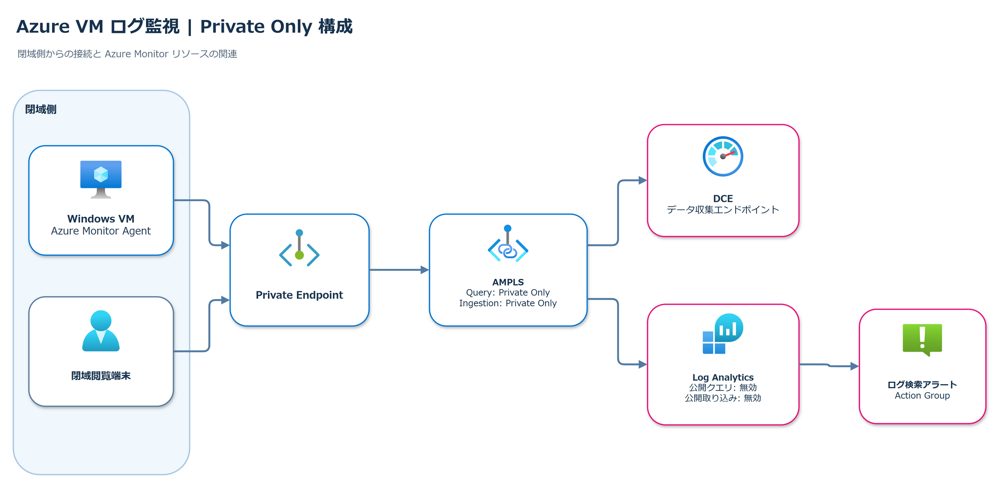

# SRE Agent Private Log Analytics

Azure Monitor の Log Analytics ワークスペースを Azure Monitor Private Link Scope (AMPLS) で閉域化し、Azure SRE Agent の VNet 統合から KQL を実行できることを確認するための検証手順です。



## 検証内容

- Log Analytics ワークスペースと AMPLS、Private Endpoint、Private DNS の構成
- Azure SRE Agent 専用サブネットの作成と VNet 統合
- Azure SRE Agent のマネージド ID に対するログ照会権限の設定
- Log Analytics の公開クエリを無効化した状態での KQL 実行
- 任意での Azure Monitor Agent、DCE、DCR、Windows イベント収集の確認

Log Analytics コネクタの通信は Azure SRE Agent の VNet 統合を経由しないため、閉域経路の検証には組み込み Azure 可観測性を使用します。

## 手順書

- [Azure SRE Agent VNet 統合から閉域 Log Analytics を照会する検証手順](verification/2026-10-13-sre-agent-vnet-ampls-log-analytics-runbook.md)

## ディレクトリ

```text
.
├── README.md
├── assets/
│   ├── 2026-10-13-sre-agent-vnet-integration.png
│   └── azure-vm-dcr-ampls-private-only.png
└── verification/
    └── 2026-10-13-sre-agent-vnet-ampls-log-analytics-runbook.md
```

## 注意事項

- リソース名、ARM リソース ID、サブスクリプション、リソース グループなどのプレースホルダーは、検証環境の値に置き換えてください。
- 既存の AMPLS、Private DNS、DCE、DCR、VNet、サブネットを変更する前に、共有リソースへの影響を確認してください。
- SRE Agent の VNet 統合はエグレス通信を対象とします。
- 公開アクセスの無効化や VNet の切断を伴う反証試験は、変更承認と切り戻し手順を用意して実施してください。
