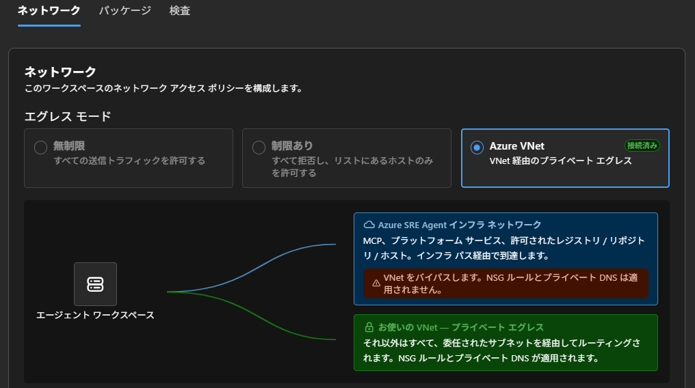

# Azure SRE Agent VNet 統合から閉域 Log Analytics を照会する検証手順


## 1. 到達目標と重要な制約

### 1.1 到達目標

本検証では、次の状態を合格とする。

1. Log Analytics ワークスペースと、任意で使用する DCE が AMPLS に登録されている。
2. AMPLS の Private Endpoint と Private DNS が、SRE Agent を統合する VNet から利用できる。
3. Log Analytics ワークスペースの公開クエリアクセスが無効である。
4. Azure SRE Agent 用の専用サブネットが `/27` 以上で、`Microsoft.App/environments` に委任されている。
5. SRE Agent のワークスペース構成で **Azure VNet** が接続済みになっている。
6. SRE Agent のマネージド ID に対象ワークスペースのログ照会権限がある。
7. SRE Agent のチャットから、**Log Analytics コネクタを使用せず**、組み込み Azure 可観測性で対象ワークスペースの KQL を実行できる。

VM のゲスト OS ログを新規に収集する必要がない場合、DCE、DCR、AMA、テストイベントの手順は省略できる。
既に対象ワークスペースへデータが到着していれば、その既存テーブルを SRE Agent から照会する。

### 1.2 Log Analytics コネクタを本検証の主経路にしない

Azure SRE Agent は、Log Analytics コネクタなしでも、組み込み Azure 可観測性を使用して Azure Monitor リソースを検出し、raw KQL を実行できる。[^sre-observability][^sre-connectors]

一方、Azure SRE Agent の公式ネットワーク資料では、**コネクタ通信は Public internet を使用し、VNet 経由にはならない**と記載されている。したがって、Log Analytics コネクタを使用してクエリが成功しても、「SRE Agent の VNet 統合から閉域ワークスペースへ到達した」ことの証明にはならない。[^sre-network]

本検証では次の条件を守る。

- Log Analytics コネクタは作成しない、または検証中は使用しない。
- チャットでは対象ワークスペースの ARM リソース ID を指定し、**組み込み Azure 可観測性 / KQL を使用し、コネクタを使わない**よう明示する。
- クエリ成功時に、実行されたツールやクエリをチャット結果で確認する。
- 対象ワークスペースの公開クエリを無効化した状態で成功を確認する。

### 1.3 SRE Agent VNet 統合の性質

Azure VNet モードでは、SRE Agent の非プラットフォーム系アウトバウンド通信が、委任サブネットから VNet のルート、NSG、Firewall、Private DNS を使用して送信される。Azure Monitor、Log Analytics、Key Vault など、Private Endpoint 配下のリソースへ到達できる。[^sre-network]

ただし、次を区別する。

- SRE Agent のオーケストレーション、モデル エンドポイント、プラットフォーム テレメトリは、Azure SRE Agent の管理インフラを使用する。
- VNet 統合は **エグレスのみ**。SRE Agent 自体への Private Endpoint によるインバウンド接続を構成する機能ではない。
- MCP、パッケージ レジストリ、コード リポジトリ、追加ホストを「インフラ ネットワーク」で許可すると、その対象通信は VNet をバイパスする。
- コネクタ通信は VNet 経由にならない。

## 2. 使用する値と作業開始ゲート

### 2.1 使用する値

次の値は例示の仮名である。実際の操作では承認済みの値へ置き換える。

| 項目 | 使用する値 | 備考 |
| --- | --- | --- |
| サブスクリプション / RG | `＜subscription＞` / `＜rg＞` | 既存共有リソースは別 RG のままでよい。 |
| リージョン | `＜region＞` | ワークスペース、任意の VM / DCR / DCE、SRE Agent の対応リージョンを確認する。 |
| VNet | `＜vnet＞` | AMPLS の Private Endpoint と SRE Agent が到達可能な VNet。 |
| Private Endpoint 用サブネット | `＜pe-subnet＞` | 既存設計に従う。 |
| SRE Agent 用サブネット | `＜sre-agent-subnet＞` | `/27` 以上、`Microsoft.App/environments` に委任する専用サブネット。 |
| 任意の VM / VM サブネット | `＜vm＞` / `＜vm-subnet＞` | 新規イベント収集を検証する場合のみ。 |
| Log Analytics ワークスペース | `＜law＞` | 公開クエリを無効化する対象。 |
| AMPLS / Private Endpoint | `＜ampls＞` / `＜pe＞` | Log Analytics のプライベート接続。 |
| 任意の DCE / DCR | `＜dce＞` / `＜dcr＞` | VM の AMA 構成取得と Windows イベント収集を試す場合のみ。 |
| Azure SRE Agent | `＜sre-agent＞` | Running 状態の検証対象。 |
| ワークスペース ARM ID | `＜law-resource-id＞` | SRE Agent のチャットで照会先を固定する。 |
| VM ARM ID | `＜vm-resource-id＞` | 任意のテストイベント照会で使用する。 |

### 2.2 作業開始のゲート

1. Azure portal 上部の **[ディレクトリとサブスクリプション]** で対象を確認する。
2. 既存の VNet、サブネット、NSG、UDR、Azure Firewall、Private DNS、AMPLS、Private Endpoint、Log Analytics の公開アクセス設定を棚卸しする。
3. 対象 SRE Agent が **Running** 状態であることを確認する。
4. 作業者に次の権限があることを確認する。

   | 操作 | 必要な権限の例 |
   | --- | --- |
   | SRE Agent のネットワーク設定 | 対象 SRE Agent の `SRE Agent Administrator` |
   | SRE Agent とサブネットの接続 | 対象サブネットの `Network Contributor`、または `Microsoft.Network/virtualNetworks/subnets/join/action` を含む権限 |
   | AMPLS / PE / DNS / LAW の変更 | 対象リソースへの変更権限 |
   | SRE Agent によるログ照会 | SRE Agent のマネージド ID に `Log Analytics Reader` 等のログ照会権限 |

5. SRE Agent 用サブネットに既存の委任・リソースがないか確認する。既存ワークロードと共有せず、専用サブネットを使用する。
6. Private DNS ゾーンが対象 VNet にリンクされているか、社内 DNS を使用する場合は Azure DNS への条件付き転送があるか確認する。
7. 共有 AMPLS、共有 Private DNS、既存 DCE の変更影響が不明な場合は、変更せず担当者に確認する。

## 3. VNet とサブネットを準備する

### 3.1 既存 VNet を確認する

1. **[仮想ネットワーク] → `＜vnet＞` → [アドレス空間] / [サブネット] / [DNS サーバー]** を開く。
2. `＜vnet＞` から `＜pe-subnet＞` への到達性と、Private DNS ゾーンのリンクを確認する。
3. UDR で Azure Firewall / NVA を使用する場合、Log Analytics の Private Endpoint への経路と、SRE Agent が必要とする承認済みアウトバウンド経路をネットワーク担当者と確認する。

### 3.2 SRE Agent 用サブネットを作成する

1. **[仮想ネットワーク] → `＜vnet＞` → [サブネット] → [サブネット]** を開く。
2. 名前 `＜sre-agent-subnet＞`、承認済みのアドレス範囲を指定する。
3. サブネット サイズは **`/27` 以上**とする。
4. **[サービスへのサブネットの委任]** で `Microsoft.App/environments` を選択する。
5. 組織標準の NSG と UDR を適用する。Private Endpoint と必要なアウトバウンド通信を妨げないことを確認する。
6. **[保存]** 後、サブネットの委任とアドレス範囲を再確認する。

**完了確認:** `＜sre-agent-subnet＞` が `/27` 以上で、`Microsoft.App/environments` に委任されている。[^sre-network-config]

## 4. Log Analytics ワークスペースを用意する

1. **[Log Analytics ワークスペース] → `＜law＞`** を開く。新規の場合は、承認済みのサブスクリプション、RG、リージョン、名前で作成する。
2. **[概要] / [プロパティ]** から次を記録する。
   - ワークスペース名
   - ARM リソース ID
   - Workspace ID
   - リージョン
3. **[ネットワークの分離 (Network Isolation)]** を開き、次の変更前値を記録する。
   - 公開ネットワークからのデータ取り込み
   - 公開ネットワークからのクエリ
4. この時点では公開アクセスを無効化しない。AMPLS、Private Endpoint、DNS、SRE Agent の VNet 統合を先に構成する。

## 5. 任意: VM から新規ログを収集する場合だけ DCE を用意する

既存データを SRE Agent から照会するだけなら、本章、8 章、9 章の VM / DCR 関連手順は省略できる。

1. **[モニター] → [データ収集エンドポイント]** を開く。
2. VM と同一リージョンで利用できる DCE があれば、既存関連付けと共有影響を確認して再利用する。
3. 新規の場合は **[作成]** から `＜dce＞` を作成する。
4. **DCE → [概要]** で、構成アクセスの FQDN とリソース ID を記録する。

DCE は AMA の構成取得に使用する。Windows イベントから Log Analytics へのデータ送信先そのものとして DCE を指定する手順ではない。[^dce]

## 6. AMPLS に Log Analytics と任意の DCE を登録する

1. **[モニター] → [プライベート リンク スコープ]** を開く。
2. 既存 AMPLS を使う場合は、共有 DNS と他のワークスペースへの影響を確認する。
3. 新規作成する場合、名前 `＜ampls＞` とし、**クエリ アクセス モード = Private Only、インジェスト アクセス モード = Private Only** を選択する。
4. **AMPLS → [Azure Monitor リソース] → [追加]** で `＜law＞` を追加する。
5. VM の AMA / DCR 検証を行う場合のみ、同じ画面から `＜dce＞` も追加する。
6. 一覧に対象ワークスペースと、必要な場合だけ DCE が表示されることを確認する。

**完了確認:** `＜law＞` が AMPLS に登録され、クエリとインジェストのアクセス モードが `Private Only` である。[^ampls]

## 7. Private Endpoint と Private DNS を構成する

### 7.1 Private Endpoint

1. **AMPLS → [プライベート エンドポイント接続] → [プライベート エンドポイント]** を開く。
2. 名前 `＜pe＞`、対象 AMPLS、ターゲット サブリソース `azuremonitor` を選択する。
3. VNet `＜vnet＞`、サブネット `＜pe-subnet＞` を選択する。
4. 既存 DNS 設計を確認し、承認済みの場合のみ Private DNS ゾーンと統合する。
5. 作成後、Private Endpoint 接続が **Approved** であることを確認する。

### 7.2 Private DNS

1. **Private Endpoint → `＜pe＞` → [DNS の構成]** で FQDN とプライベート IP を確認する。
2. Private DNS ゾーンのレコードと、`＜vnet＞` への VNet リンクを確認する。
3. Azure Monitor で使用される代表的なゾーンを確認する。

   ```text
   privatelink.monitor.azure.com
   privatelink.oms.opinsights.azure.com
   privatelink.ods.opinsights.azure.com
   privatelink.agentsvc.azure-automation.net
   privatelink.blob.core.windows.net
   ```

4. 固定の A レコードを推測で作らず、Private Endpoint の **[DNS の構成]** に表示される FQDN と IP を正本にする。
5. 社内 DNS を使用する場合、Azure DNS への条件付き転送を DNS 担当者と確認する。

**完了確認:** SRE Agent を接続する `＜vnet＞` から、Log Analytics のクエリ FQDN が Private Endpoint のプライベート IP に解決される構成になっている。[^ampls]

## 8. 任意: VM ゲストの Windows イベントを収集する DCR までの設定

本章は、SRE Agent のチャットで照会するテストデータを新規に作る場合だけ実施する。
既に `Heartbeat`、`Event`、`AzureActivity` など照会可能なデータがある場合は省略できる。

### 8.1 任意: VM と DCE の関連付け

1. **[モニター] → [データ収集エンドポイント] → `＜dce＞` → [リソース]** を開く。
2. VM の既存 DCE 関連付けを確認する。
3. 別 DCE を追加すると既存関連付けを置き換える可能性があるため、共有 VM では承認を得る。
4. **[追加]** で `＜vm＞` を選び **[適用]** する。

### 8.2 任意: Windows イベントを収集する DCR

1. **[モニター] → [データ収集ルール] → [作成]** を開く。
2. 名前 `＜dcr＞`、送信先ワークスペースと同じリージョン、Windows ゲストログを扱えるプラットフォーム種類を指定する。
3. **[リソース] → [リソースの追加]** で `＜vm＞` を選択する。
4. DCR 作成画面に **[データ収集エンドポイントの有効化]** がある場合は、手順 8.1 と同じ `＜dce＞` を指定する。
5. **[収集して配信 (Collect and deliver)] → [新しいデータ ソースを追加]** を開く。
6. データ ソースの種類で **[Windows イベント ログ]** を選択する。
7. **[基本]** でログ `Application`、レベル `Error` のみを選択する。`System`、`Security`、`Information` は選択しない。
8. **[宛先]** で **[Azure Monitor ログ]**、ワークスペース `＜law＞` を選択する。
9. データ ソースを保存し、**[確認および作成] → [作成]** を実行する。
10. 次を確認する。
    - DCR の **[リソース]** に `＜vm＞` がある。
    - DCR の **[データ ソース]** が Application / Error である。
    - 送信先が `＜law＞` である。
    - VM に `AzureMonitorWindowsAgent` が導入されている。
    - VM と `＜dce＞` の関連付けがある。

収集先は Log Analytics の `Event` テーブル。[^windows-event]

## 9. 任意: DNS / 疎通と実イベントの取り込みを検証する

本章は、VM / DCR の収集経路も検証する場合だけ実施する。
本検証の主目的は SRE Agent の VNet 統合からのクエリであるため、既存データを使用する場合は省略できる。

### 9.1 任意: VM から Azure Monitor の Private Endpoint を確認する

1. Private Endpoint の **[DNS の構成]** に表示された DCE 構成取得、ワークスペース取り込みの FQDN を確認する。
2. VM 上で次を実行する。

   ```powershell
   nslookup <fqdn>
   Test-NetConnection -ComputerName <fqdn> -Port 443
   ```

3. FQDN が想定するプライベート IP に解決され、`TcpTestSucceeded` が `True` であることを確認する。

DNS 解決だけでは、実際のアプリケーション通信成功を証明しない。

### 9.2 任意: Windows イベントを生成する

VM の管理者 Windows PowerShell 5.1 で実行する。
既存のイベントソースと競合する場合は、別名を使用する。

```powershell
$source = 'AzureVmDcrPoc'
if (-not [System.Diagnostics.EventLog]::SourceExists($source)) {
    New-EventLog -LogName Application -Source $source
}
Write-EventLog -LogName Application -Source $source -EventId 9001 -EntryType Error -Message 'Azure Monitor DCR PoC test event'
```

イベント ビューアーの **[Windows ログ] → [Application]** で、Source `AzureVmDcrPoc`、Event ID `9001` を確認する。

### 9.3 任意: 取り込みを確認する

この確認は、ワークスペースの公開アクセスを無効化する前に、承認済みの閲覧経路から実施する。

```kusto
Heartbeat
| where TimeGenerated > ago(30m)
| where _ResourceId =~ "<VM_RESOURCE_ID>"
| summarize LastSeen=max(TimeGenerated), Samples=count() by Computer
```

```kusto
Event
| where TimeGenerated > ago(1h)
| where _ResourceId =~ "<VM_RESOURCE_ID>"
| where EventLog == "Application" and Source == "AzureVmDcrPoc" and EventID == 9001
| project TimeGenerated, Computer, EventLevelName, EventID, Source, Message
| order by TimeGenerated desc
```

**完了確認:** `Heartbeat` または `Event` に対象 VM のデータがあり、SRE Agent のチャットで照会するデータが準備されている。

## 10. Log Analytics の公開アクセスを無効化する

### 10.1 変更前確認

1. `＜law＞` を使用する既存ユーザー、アプリ、アラート、Automation、他の SRE Agent、診断ツールを確認する。
2. 公開クエリ / 公開取り込みを無効化した場合の影響と切り戻し担当者を確認する。
3. AMPLS、Private Endpoint、Private DNS、VNet リンクが完成していることを確認する。
4. VM からの新規取り込みも継続させる場合は、DCE、DCR、AMA の閉域経路を確認する。

### 10.2 公開アクセスの切替

1. **AMPLS → [アクセス モード]** で、クエリとインジェストが `Private Only` であることを確認する。
2. **[Log Analytics ワークスペース] → `＜law＞` → [ネットワークの分離]** を開く。
3. 本検証で必須となる **公開ネットワークからのクエリ = 無効**へ変更する。
4. VM からの取り込みも完全に閉域化する検証を行う場合のみ、影響を確認して **公開ネットワークからのデータ取り込み = 無効**へ変更する。
5. 変更時刻、変更前後の値、承認者、切り戻し方法を記録する。

**重要:** AMPLS の `Private Only` と、ワークスペース自身の公開アクセス設定は別である。閉域クエリの検証では、ワークスペースの公開クエリも無効にする。[^ampls-security]

## 11. Azure SRE Agent の VNet 統合を設定する

### 11.1 Portal で Azure VNet を接続する

1. Azure portal で `＜sre-agent＞` を開く。
2. SRE Agent ポータルの **[Settings] → [Workspace configuration]** を開く。
3. **[Networking]** タブを開く。
4. エグレス モードで **[Azure VNet]** を選択する。
5. **[Browse subnets...]** を選択し、次を指定する。
   - Subscription: `＜subscription＞`
   - Resource group: `＜vnet＞` のリソース グループ
   - Virtual network: `＜vnet＞`
   - Subnet: `＜sre-agent-subnet＞`
6. **[Connect]** を選択する。
7. **Use VNet's private DNS** が有効になっていることを確認する。
8. 本検証では Log Analytics のクエリを VNet 経由にするため、Log Analytics のホストを **Additional hosts** のバイパス対象に追加しない。
9. MCP、パッケージ、コードリポジトリ等の「On the infra network」設定は、今回のクエリ検証に不要なものを追加しない。既存設定がある場合は変更前値を記録する。
10. **[Save]** を選択する。
11. Azure VNet カードに **Connected** が表示されることを確認する。



画面の青色経路は Azure SRE Agent の管理インフラを使用する通信であり、VNet の NSG と Private DNS は適用されない。
緑色経路はユーザー VNet の委任サブネットを経由し、NSG、ルート、Firewall、Private DNS が適用される。

### 11.2 接続後の確認

1. `＜sre-agent-subnet＞` の委任が維持されていることを確認する。
2. VNet の Private DNS ゾーン リンクと、Log Analytics の Private Endpoint レコードを再確認する。
3. Azure Firewall / NVA を使用する場合、SRE Agent 用サブネットから Private Endpoint への通信が許可されることを確認する。
4. VNet の接続状態、接続したサブネット、保存時刻を証跡として保存する。

サブネットを変更する場合は、公式手順上、VNet を切断して再接続する必要がある。共有検証中に無断で切り替えない。[^sre-network-config]

## 12. SRE Agent のマネージド ID にログ照会権限を付与する

1. SRE Agent の **[Settings] → [Azure settings] → [Go to Identity]** から、SRE Agent のユーザー割り当てマネージド ID を確認する。
2. `＜law＞` またはそのリソース グループの **[アクセス制御 (IAM)]** を開く。
3. SRE Agent のマネージド ID に、最小権限で `Log Analytics Reader` を付与する。
4. Azure Resource Graph でワークスペースを検出させる場合、対象 RG に `Reader` があることも確認する。
5. メトリックや Azure Monitor の状態も照会する場合、必要なスコープの `Monitoring Reader` を確認する。
6. 本検証は読み取り専用とし、不要な Contributor 権限を付与しない。

Azure SRE Agent 作成時に対象 RG をスコープとして選択している場合、Reader、Log Analytics Reader、Monitoring Reader が事前構成される。対象 RG を選択していない場合、マネージド ID に権限がないため明示的な割り当てが必要。[^sre-permissions]

## 13. SRE Agent のチャットから Log Analytics を照会する

### 13.1 テーブル一覧を確認する

SRE Agent の **[Chat]** を開き、次を送信する。

```text
Log Analytics connector は使用しないでください。
組み込み Azure 可観測性を使用し、次の Log Analytics workspace を Azure Monitor Logs / KQL で照会してください。

Workspace ARM resource ID:
＜law-resource-id＞

まず、この workspace で直近24時間にデータが存在するテーブルを一覧表示してください。
実行したツール、対象 workspace、KQL、結果件数も示してください。
```

確認項目:

- 対象ワークスペースが `＜law＞` である。
- Log Analytics コネクタを使用していない。
- KQL または Azure Monitor Logs の実行が確認できる。
- 公開クエリを無効化した状態で結果が返る。
- テーブル一覧または件数が表示される。

### 13.2 Heartbeat を確認する

VM のデータがある場合は次を送信する。

```text
Log Analytics connector は使用しないでください。
組み込み Azure 可観測性を使用し、workspace ＜law-resource-id＞ で次の KQL を実行してください。
結果、対象 workspace、実行したツール、実際に実行した KQL を示してください。

Heartbeat
| where TimeGenerated > ago(30m)
| where _ResourceId =~ "＜vm-resource-id＞"
| summarize LastSeen=max(TimeGenerated), Samples=count() by Computer
```

### 13.3 任意の Windows イベントを確認する

8～9 章を実施した場合は次を送信する。

```text
Log Analytics connector は使用しないでください。
組み込み Azure 可観測性を使用し、workspace ＜law-resource-id＞ で次の KQL を実行してください。
結果、対象 workspace、実行したツール、実際に実行した KQL を示してください。

Event
| where TimeGenerated > ago(1h)
| where _ResourceId =~ "＜vm-resource-id＞"
| where EventLog == "Application" and Source == "AzureVmDcrPoc" and EventID == 9001
| project TimeGenerated, Computer, EventLevelName, EventID, Source, Message
| order by TimeGenerated desc
```

### 13.4 閉域経路の判定

次のすべてがそろった場合に合格とする。

- [ ] Log Analytics の公開クエリが無効。
- [ ] AMPLS の Query access mode が `Private Only`。
- [ ] Log Analytics ワークスペースが AMPLS に登録済み。
- [ ] AMPLS の Private Endpoint が Approved。
- [ ] Private DNS が `＜vnet＞` にリンク済み。
- [ ] SRE Agent の Azure VNet カードが Connected。
- [ ] Log Analytics のホストが Additional hosts 等の VNet バイパス対象ではない。
- [ ] Log Analytics コネクタを使用していない。
- [ ] SRE Agent の組み込み Azure 可観測性による KQL が成功。
- [ ] 期待したワークスペース、テーブル、結果が確認できる。

この組み合わせをもって、SRE Agent の VNet 統合から Private Endpoint 配下の Log Analytics を照会できたと判定する。公式手順も、公開アクセスを無効化した Private Endpoint 配下の Log Analytics をエージェントに照会させ、成功を確認する方法を案内している。[^sre-network-config]

## 14. 任意の反証試験

より強い証跡が必要な場合のみ、変更承認と切り戻し手順を用意して実施する。

1. 正常系のクエリ成功を記録する。
2. SRE Agent の VNet 接続を切断する。
3. Log Analytics の公開クエリが無効のまま、同じチャットクエリを実行する。
4. 到達失敗になることを確認する。
5. 直ちに `＜vnet＞` / `＜sre-agent-subnet＞` へ再接続する。
6. 同じクエリが再度成功することを確認する。

この試験は SRE Agent の通信を一時的に変更するため、共有環境では実施しない。
VNet 切断中にコネクタや別経路へフォールバックした結果を正常と誤認しない。

## 15. 切り分け

| 症状 | 確認順序 |
| --- | --- |
| SRE Agent でサブネットを選択できない | サブネットが `/27` 以上か → `Microsoft.App/environments` 委任 → 作業者の subnet join 権限 → リージョン / サブスクリプション。 |
| Azure VNet が Connected にならない | SRE Agent の Running 状態 → SRE Agent Administrator → Network Contributor → サブネットの既存委任・IP 空き。 |
| クエリが権限エラー | SRE Agent の UAMI → `Log Analytics Reader` のスコープ → 対象ワークスペース / RG → RBAC 反映待ち。 |
| クエリが timeout / 接続失敗 | Public query Disabled を確認 → AMPLS 登録 → PE Approved → Private DNS / VNet link → SRE subnet の NSG / UDR / Firewall → Additional hosts の設定。 |
| 接続は成功するが閉域の証明にならない | Log Analytics connector を使っていないか → Public query が Disabled か → SRE Agent が Azure VNet Connected か → 対象 LAW が AMPLS 配下か。 |
| VM の Heartbeat がない | 任意の DCE 関連付け → AMA → DCR → VM の ID → DCE 構成 FQDN と取り込み FQDN の DNS / 443。 |
| Heartbeat はあるが Event がない | VM の Application ログ → DCR の Application / Error → DCR の VM 関連付け → 送信先 LAW → KQL の Source / EventID / 時間範囲。 |
| SRE Agent がコネクタを使ってしまう | コネクタを無効化 / 削除するか、組み込み Azure 可観測性と ARM ID / KQL を明示して新しいチャットで再試験する。 |

Azure SRE Agent が NSG 拒否またはルートなしで到達できない場合、通常のワークロードと同様のネットワークエラーを受ける。調査出力に到達不能が示されても、エージェントは利用可能な他のデータで処理を続ける場合があるため、部分結果をクエリ成功と扱わない。[^sre-network]

## 16. 証跡と終了処理

### 16.1 保存する証跡

- Log Analytics の公開クエリ設定が無効である画面。
- AMPLS のアクセス モード、Azure Monitor リソース一覧。
- Private Endpoint の Approved 状態と DNS 構成。
- `＜sre-agent-subnet＞` のアドレス範囲と委任。
- SRE Agent の Azure VNet Connected 画面。
- SRE Agent UAMI の Log Analytics Reader 割り当て。
- SRE Agent チャットのプロンプト、実行ツール、KQL、結果。
- 任意で、テストイベント、DCR、AMA、Event テーブルの結果。
- 作業時刻、実施者、承認者、変更前後の値。

### 16.2 終了・切り戻し

1. 検証後も閉域構成を維持するか、環境オーナーに確認する。
2. SRE Agent の VNet 接続を切り戻す場合、閉域ワークスペースへのクエリができなくなることを確認する。
3. 公開アクセスを再有効化する場合は、セキュリティ承認と変更記録を残す。
4. 既存 AMPLS、Private DNS、Private Endpoint、VNet を無断で削除しない。
5. 任意で作成した DCR、DCE、イベントソース、VM の削除・保持をオーナーに確認する。
6. 不要な過剰 RBAC がないことを確認する。

## 参考資料

[^sre-network-config]: Configure Network Controls for Azure SRE Agent, https://learn.microsoft.com/en-us/azure/sre-agent/configure-network-controls
[^sre-network]: Azure SRE Agent Network Integration, https://learn.microsoft.com/en-us/azure/sre-agent/network-integration
[^sre-observability]: Diagnose with Azure Observability - Azure SRE Agent, https://learn.microsoft.com/en-us/azure/sre-agent/diagnose-azure-observability
[^sre-connectors]: Log Analytics & Application Insights connectors in Azure SRE Agent, https://learn.microsoft.com/en-us/azure/sre-agent/log-analytics-app-insights
[^sre-permissions]: Agent Permissions in Azure SRE Agent, https://learn.microsoft.com/en-us/azure/sre-agent/permissions
[^ampls]: Azure Monitor のプライベート リンクを構成する, https://learn.microsoft.com/ja-jp/azure/azure-monitor/logs/private-link-configure
[^ampls-security]: Azure Private Link を使用してネットワークを Azure Monitor に接続する, https://learn.microsoft.com/ja-jp/azure/azure-monitor/logs/private-link-security
[^dce]: Azure Monitor のデータ収集エンドポイント, https://learn.microsoft.com/ja-jp/azure/azure-monitor/data-collection/data-collection-endpoint-overview
[^windows-event]: Azure Monitor を使用して仮想マシンから Windows イベントを収集する, https://learn.microsoft.com/ja-jp/azure/azure-monitor/vm/data-collection-windows-events
